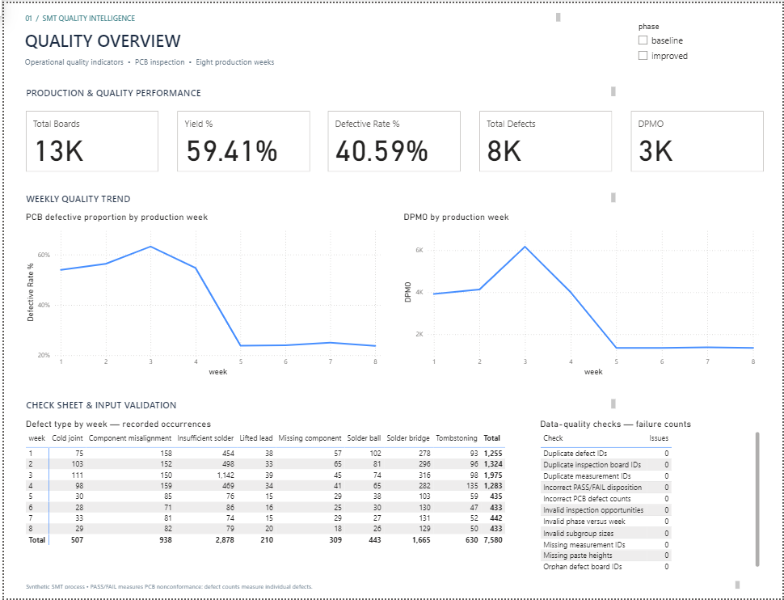
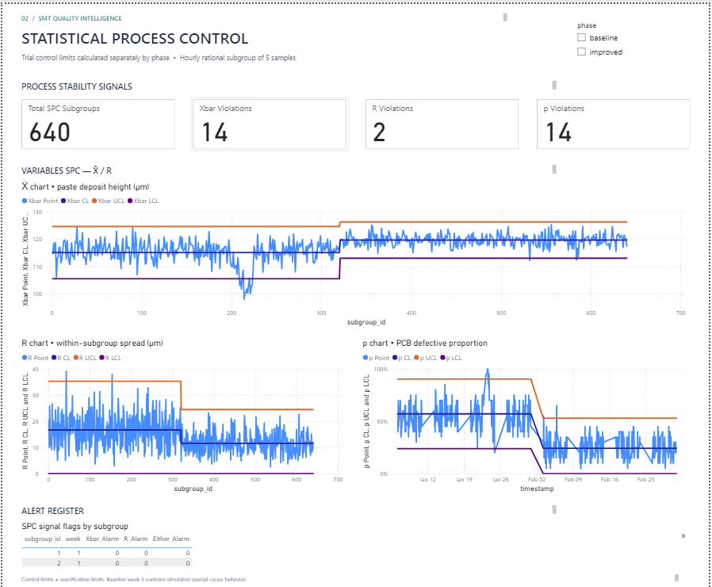
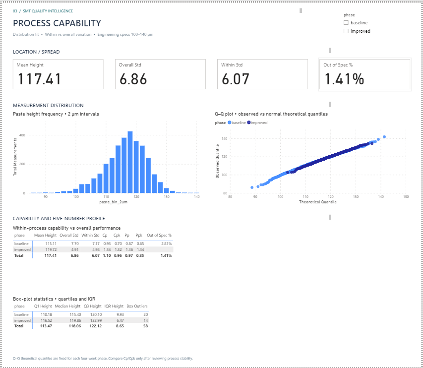
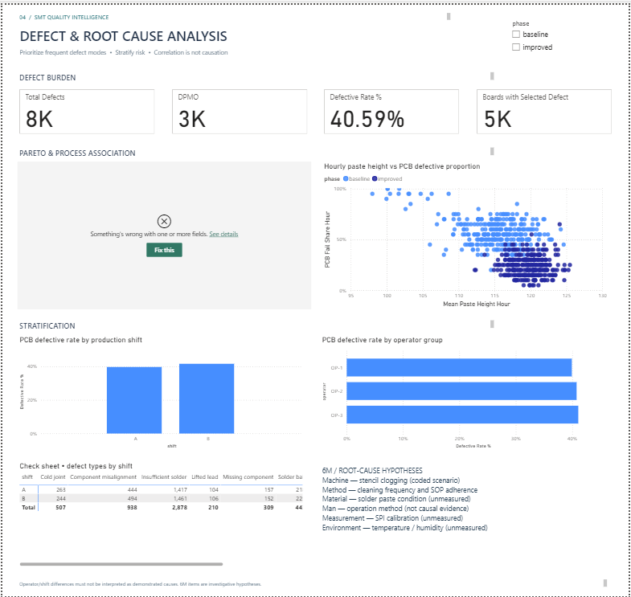
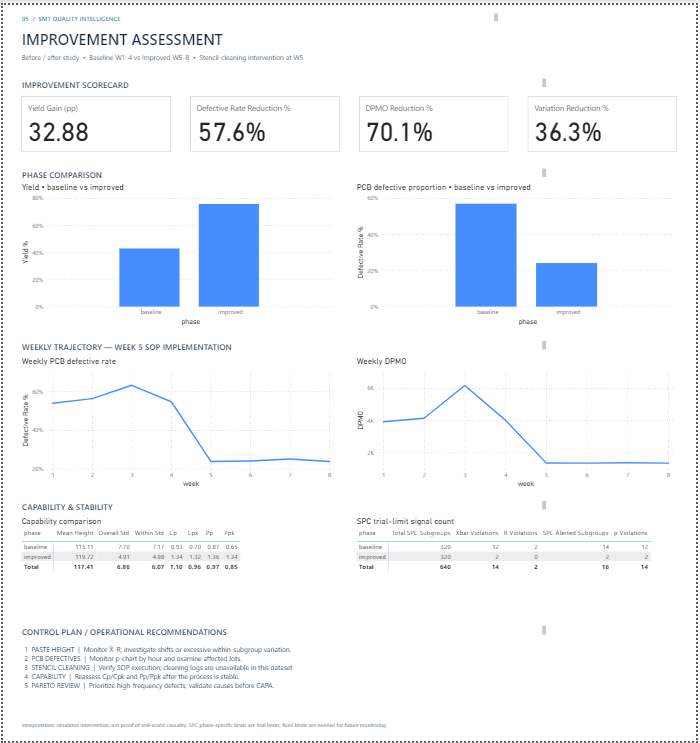
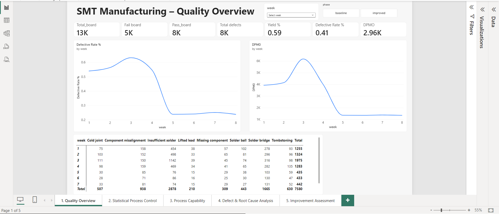
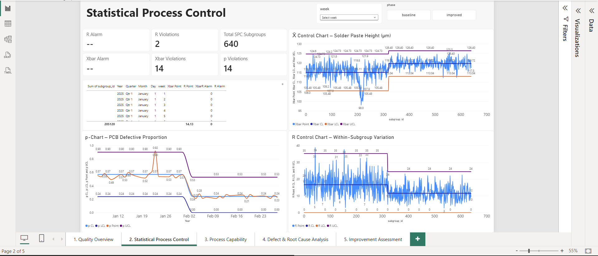
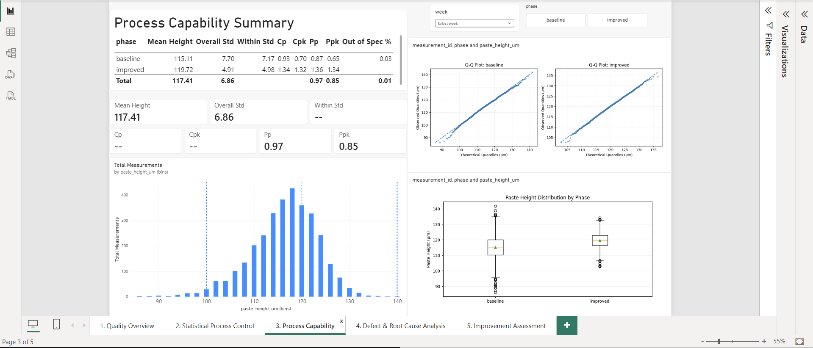
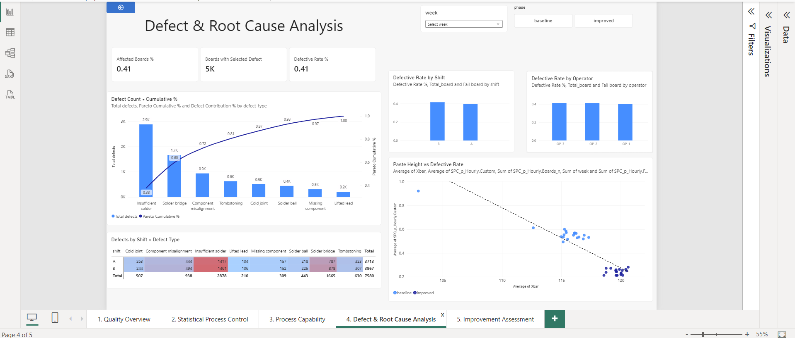
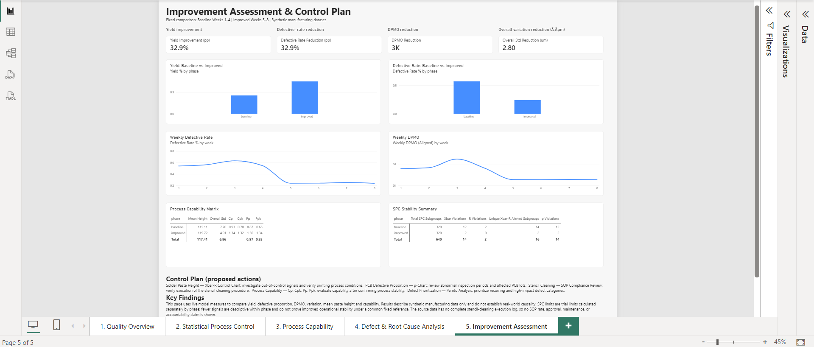

# Lean Six Sigma SMT Quality Dashboard

An end-to-end Power BI portfolio project that applies the DMAIC framework to a simulated Surface-Mount Technology (SMT) printed-circuit-board assembly process. The completed dashboard turns process and inspection data into a practical quality-improvement story: detect the process issue, quantify its impact, validate the improvement, and define how the process should be controlled.

> **Data note:** the dataset is synthetic and reproducible. It was designed to reflect a realistic manufacturing-quality scenario for portfolio and learning purposes; it is not production data.

## Featured deliverable

The primary deliverable is the agent-assisted report in [`phép thuật online`](./ph%C3%A9p%20thu%E1%BA%ADt%20online/):

```text
phép thuật online/
└── SMT_Quality_Compare.pbip
```

This is the most complete version of the project. It contains the final comparison-oriented Power BI report, semantic model, DAX measures, SPC analysis, capability analysis, defect Pareto analysis, and improvement/control-plan content.

Open the `.pbip` file in Power BI Desktop to explore the report.

## Business case

The process under study is an SMT line with the flow **solder-paste print → component placement → reflow**. The critical-to-quality (CTQ) measure is solder-paste deposit height, measured by SPI on a reference pad.

| Item | Definition |
|---|---|
| CTQ | Solder-paste deposit height |
| Target | 120 µm |
| Specification limits | LSL 100 µm / USL 140 µm |
| Sampling | Rational subgroups of 5 boards, once per production hour |
| Inspection | 100% board inspection; 200 solder-joint opportunities per board |
| Analysis period | 8 weeks, two shifts per day, Monday–Friday |

The simulated case follows a clear DMAIC narrative:

- **Weeks 1–4 — Baseline:** the printing process is low-centered and overly variable.
- **Week 3 — Special cause:** stencil clogging causes paste starvation and a spike in insufficient-solder defects.
- **Weeks 5–8 — Improved state:** an under-stencil-wipe / cleaning SOP recenters the process and reduces variation.

## Key outcomes

| Metric | Baseline (weeks 1–4) | Improved (weeks 5–8) |
|---|---:|---:|
| Mean paste height | 115.1 µm | 119.7 µm |
| Standard deviation | 7.70 µm | 4.91 µm |
| Cp / Cpk | 0.87 / 0.65 | 1.36 / 1.34 |
| Defective fraction | 0.57% | 0.24% |
| DPMO | 4,560 | 1,362 |
| Process sigma | 4.11 σ | 4.50 σ |

The analysis identifies **insufficient solder** as the leading defect. Its increase coincides with the control-chart signals during the stencil-clogging event, linking the process excursion to the defect pattern. Following the cleaning-SOP intervention, the process is recentered, variation decreases, and the Cpk exceeds the conventional 1.33 capability threshold.

## Dashboard scope

The completed report covers the full improvement cycle:

| DMAIC phase | Analysis delivered |
|---|---|
| Define | Process context, CTQ, targets, and specification limits |
| Measure | Yield, defect rate, DPMO, process sigma, and baseline performance |
| Analyze | X-bar/R and p control charts, capability indices, defect Pareto, trends, and process relationships |
| Improve | Baseline-versus-improved comparisons for yield, defects, DPMO, mean, variation, Cp, and Cpk |
| Control | Stability monitoring and a proposed control plan for the improved process |

## Project versions and authorship

This repository intentionally preserves the working path behind the final report.

| Folder | Role |
|---|---|
| [`SMT_quality_dashboard`](./SMT_quality_dashboard/) | **Manual build** — created by the portfolio author without Codex or Greenfield in the project name. |
| [`phép thuật online`](./ph%C3%A9p%20thu%E1%BA%ADt%20online/) | **Featured agent-assisted build** — the strongest and most complete agent-based version; use this as the main deliverable. |
| [`SMT_quality_dashboard_CODEX`](./SMT_quality_dashboard_CODEX/) | Reference iteration retained for comparison and development history. |
| [`SMT_Quality_Dashboard_Greenfield`](./SMT_Quality_Dashboard_Greenfield/) | Reference greenfield iteration retained for comparison and development history. |

The reference versions are included to show the evolution of the solution. They are not separate final deliverables.

## Repository structure

```text
Lean-Sigma-Learners-Portfolio/
├── data/                                  # Synthetic source data and dictionary
├── generate_data.py                       # Seeded data generator
├── SMT_quality_dashboard/                 # Manual Power BI build
├── phép thuật online/                     # Featured final agent-assisted PBIP report
├── SMT_quality_dashboard_CODEX/           # Reference iteration
├── SMT_Quality_Dashboard_Greenfield/      # Reference iteration
└── README.md
```

## Data and reproducibility

The input data lives in [`data`](./data/) and includes continuous measurements, inspection records, defect records, specifications, and a data dictionary. The generator uses a fixed random seed, so the same dataset can be recreated locally.

```bash
pip install numpy pandas
python generate_data.py
```

See [`data/data_dictionary.md`](./data/data_dictionary.md) for the field-level definitions.

## Dashboard pages

The featured report is organized as a five-page quality-intelligence application:

| Page | Purpose | Highlights |
|---|---|---|
| **01 — Quality Overview** | Establish the operating baseline and quality performance. | Total boards, yield, defective rate, defects, DPMO, weekly trends, defect check sheet, and data-quality checks. |
| **02 — Statistical Process Control** | Identify instability and special-cause variation. | X-bar, R, and p charts; control limits; signal counts; and an alert register. |
| **03 — Process Capability** | Assess whether the process can meet engineering specifications. | Distribution, Q–Q plot, Cp/Cpk/Pp/Ppk, out-of-spec rate, and five-number profile. |
| **04 — Defect & Root Cause Analysis** | Prioritize defect modes and investigate likely causes. | Pareto analysis, hourly paste-height versus defect-rate relationship, shift/operator stratification, and 6M hypotheses. |
| **05 — Improvement Assessment** | Demonstrate the impact of the week-5 intervention and establish control. | Yield, defect-rate, DPMO, and variation improvements; before/after comparisons; capability and stability summary; control-plan recommendations. |

The report uses a consistent, clean control-room layout so a manufacturing team can move from executive KPIs to process diagnosis and then to sustainment actions without leaving the report.

## Build record

The screenshots and project folders document the contribution behind the finished portfolio:

| Report page | Build attribution |
|---|---|
| **01 — Quality Overview** | Designed and manually edited by the portfolio author. |
| **02 — Statistical Process Control** | Designed and manually edited by the portfolio author. |
| **03 — Process Capability** | Designed and manually edited by the portfolio author. |
| **04 — Defect & Root Cause Analysis** | Designed and manually edited by the portfolio author. |
| **05 — Improvement Assessment & Control Plan** | Edited with Codex assistance. |

The final agent-assisted deliverable remains the report in [`phép thuật online`](./ph%C3%A9p%20thu%E1%BA%ADt%20online/). The gallery below provides visual evidence of both the finished agent-assisted report and the manual/Codex-assisted development work.

## Dashboard gallery

### Featured agent-assisted dashboard

The following five pages are from the featured report in `phép thuật online`. Together, they tell a complete manufacturing-quality story—from the initial signal to the proposed control plan.



*Quality Overview — headline KPIs, weekly defect-rate and DPMO trends, defect check sheet, and data-quality validation results.*



*Statistical Process Control — X-bar, R, and p charts identify special-cause variation and record process signals by subgroup.*



*Process Capability — distribution, Q–Q plot, out-of-spec rate, and Cp/Cpk/Pp/Ppk comparison evaluate conformance to the 100–140 µm specification.*



*Defect & Root Cause Analysis — defect prioritization, stratification, process association, and 6M hypotheses focus the investigation on the highest-impact causes.*



*Improvement Assessment — before/after scorecard, weekly trajectory, capability and stability summary, and operational control recommendations confirm the proposed intervention.*

### Manual build and Codex-assisted refinement

These screenshots show the Power BI Desktop development path. Pages 01–04 were designed and edited manually; the final Improvement Assessment page was refined with Codex assistance.



*Manual build — Quality Overview combines board-level KPIs, week-level trends, and a defect check sheet in one operational landing page.*



*Manual build — Statistical Process Control brings the X-bar, R, and p charts together with violation counts and a subgroup-level signal table.*



*Manual build — Process Capability compares baseline and improved distributions through capability metrics, Q–Q plots, a histogram, and box plots.*



*Manual build — Defect & Root Cause Analysis visualizes Pareto priorities, defect stratification, and the relationship between paste height and defect rate.*



*Codex-assisted refinement — Improvement Assessment & Control Plan summarizes the business impact of the week-5 intervention and translates the findings into sustainment actions.*

## Tools and methods

- Power BI Desktop / PBIP
- Power Query and DAX
- Statistical Process Control: X-bar, R, and p charts
- Process capability: Cp, Cpk, Pp, and Ppk
- Lean Six Sigma DMAIC
- Python, NumPy, and pandas for deterministic data generation

## License

MIT — see [LICENSE](LICENSE).
